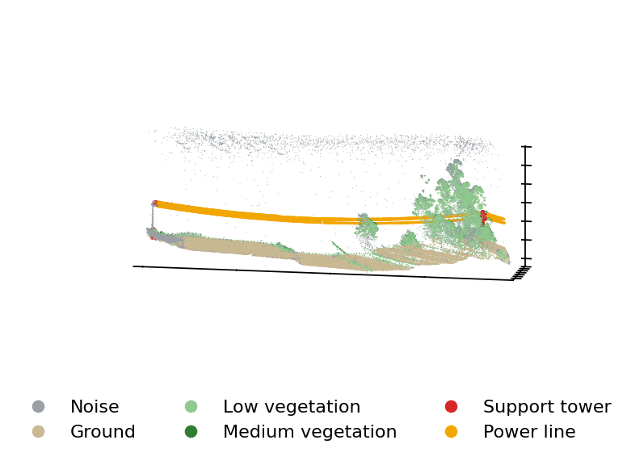

UAV-mounted LiDAR scans of rural terrain and the electrical transmission network, captured from a bird's-eye-view perspective (high point density, little occlusion, homogeneous coverage). Samples are stored as `.pt` dictionaries and span three scene types — tower-radius, power-line (two towers at opposite ends with the lines as the main actors, ~100 m), and no-tower. Drawn from:
  > Lavado, D., Soares, C., Micheletti, A., Santos, R., Coelho, A., & Santos, J. (2024). Ts40k: a 3d point cloud dataset of rural terrain and electrical transmission system. arXiv preprint arXiv:2405.13989.

  

  <b>Figure.</b> Preview of a TS40K <code>twoTowers</code> sample — per-point semantic
  labels (ground, low/medium vegetation, support tower, power line). Illustrative only;
  The sample itself is not redistributed here.

  Unlike the other two modalities, **no sample is bundled here**: TS40K is released for academic use upon request from its data owners and cannot be redistributed in this repository. The figure above is shown as a preview of what the data looks like. To run the point-cloud components, request access via the [TS40K repository](https://github.com/dlavado/TS40K), then drop one power-line sample (e.g. `twoTowers_sample_0.pt`) into this folder. Each file loads with `torch.load(...)` into a dict with keys `type` (str), `input_pcd` (`torch.tensor`, shape `(N, 3)`), `semantic_labels` (`torch.tensor`, shape `(N, 1)`), and `obj_boxes` (list of per-object dicts).
