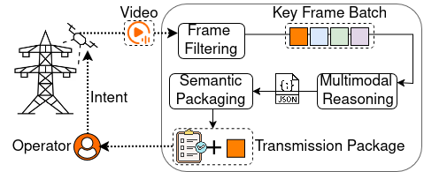

# EVLM: Intent-Driven Edge Vision Language Model for UAV-Based Power Line Inspection

This repository accompanies the paper **"EVLM: Intent-Driven Edge Vision Language Model for UAV-Based Power Line Inspection"** (2026 IEEE International Conference on Edge Computing and Communications, EDGE). It contains the prompts and component code used to implement and evaluate the EVLM pipeline.

EVLM reformulates UAV power line inspection as **intent-conditioned semantic reasoning executed directly on the drone's edge processor**, rather than closed-set object detection. Given a natural-language operator intent, it filters redundant video frames, runs a domain-adapted vision-language model (VLM) onboard, and produces a compact, verification-ready inspection report — replacing continuous raw video transmission with structured semantic outputs and a minimal set of evidence frames.

---

## System Architecture

<p align="center">
  
</p>

<p align="center"><em>Figure 1: The EVLM onboard inspection pipeline.</em></p>

---

## Repository Structure

```
EVLM/
├── Benchmarking_results/            # Onboard resource/energy benchmark CSVs (see "Benchmarking Results" below)
│   └── VLM_tegra.csv
├── EVLM_Components/                 # Pipeline stage implementations
│   ├── Frame_Filtering.py           # Stage 1 — key-frame selection + Jetson resource/energy profiling
│   ├── MultiModal_reasoning.py      # Stage 2 — onboard VLM (SmolVLM-256) inference over key frames
│   ├── Semantic_Packaging.py        # Stage 3 — parses VLM output into structured defect/component reports
│   └── Transmission_package_generation.py  # Stage 3 — builds the final evidence + report transmission package
├── Data/                            # Sample inputs (see "Dataset" below)
│   ├── 2D-Video/
│   ├── Image/
│   └── 3D-PointCloud/
├── Fine-tuning/                     # LoRA fine-tuning assets for the onboard VLM (see "Fine-tuning" below)
│   └── powerline_vqa_dataset_insplad_enh.json
├── figures/
│   └── architecture.png             # System architecture diagram (Figure 1)
├── prompts.csv                      # Operator-intent prompts used to drive the VLM (Section III)
├── requirements.txt
├── LICENSE
└── README.md
```

### Code

All commands below assume you run them from the **repository root** (so that relative defaults like `Data/2D-Video` and `prompts.csv` resolve correctly).

> **Jetson-only:** `Frame_Filtering.py` and `MultiModal_reasoning.py` both call `sudo tegrastats` to log onboard power/CPU/GPU/RAM. They are written specifically for an NVIDIA Jetson device and will not run correctly on a regular laptop/desktop, where `tegrastats` doesn't exist. `Semantic_Packaging.py` and `Transmission_package_generation.py` have no Jetson dependency and run on any machine with Python.

#### 1. [`EVLM_Components/Frame_Filtering.py`](EVLM_Components/Frame_Filtering.py) — Frame Filtering

Applies inter-frame redundancy suppression (histogram correlation, pHash, or vectorized SAD) to a folder of video segments and profiles onboard cost via `tegrastats`. Requires an NVIDIA Jetson device.

```bash
sudo python EVLM_Components/Frame_Filtering.py \
  --input_folder Data/2D-Video \
  --csv_file Benchmarking_results/filtering_tegra.csv \
  --tegra_interval 1 \
  --idle_duration 10
```

| Argument | Default | Meaning |
|---|---|---|
| `--input_folder` | `Data/2D-Video` | Folder of `.mp4`/`.avi`/`.mkv` segments to benchmark |
| `--csv_file` | `filtering_tegra.csv` | Output CSV of per-video, per-method metrics (pass `Benchmarking_results/filtering_tegra.csv` to match this repo's layout — see "Benchmarking Results" below) |
| `--tegra_interval` | `1` | `tegrastats` sampling interval (ms) |
| `--idle_duration` | `10` | Idle baseline measurement duration (s) |

#### 2. [`EVLM_Components/MultiModal_reasoning.py`](EVLM_Components/MultiModal_reasoning.py) — Multimodal Reasoning

Runs the domain-adapted SmolVLM-256 VLM over each retained key frame for every prompt in `prompts.csv`, logging inference time and onboard resource cost. Requires an NVIDIA Jetson device (see note above). `--results_dir` must contain **one subfolder per scene/segment**, each holding that scene's key-frame images — e.g. the frames a real (non-benchmark) run of the filtering stage would retain. To try it against the included sample, first nest it in a scene subfolder, e.g. `Data/Image/sample/train_gi_n1.jpg`.

```bash
python EVLM_Components/MultiModal_reasoning.py \
  --results_dir Data/Image \
  --prompts_csv prompts.csv \
  --output_dir vlm_results
```

| Argument | Default | Meaning |
|---|---|---|
| `--results_dir` | `unique_frames` | Folder containing one subfolder of images per scene |
| `--prompts_csv` | `prompts.csv` | CSV with a `prompt` column (operator-intent prompts) |
| `--output_dir` | `vlm_results` | Where per-scene, per-prompt JSON results are written |

Resource/energy metrics are additionally logged to `VLM_tegra.csv` in the current directory — this filename is a hardcoded constant in the script (not a CLI flag), so move/rename it into `Benchmarking_results/` afterward if you want it alongside `filtering_tegra.csv` (see "Benchmarking Results" below).

#### 3. [`EVLM_Components/Semantic_Packaging.py`](EVLM_Components/Semantic_Packaging.py) — Semantic Packaging

Parses raw VLM text output into structured per-frame findings (detected components, defects, and whether visual evidence is required).

```bash
python EVLM_Components/Semantic_Packaging.py \
  --input_dir vlm_results \
  --output_dir semantic_report
```

| Argument | Default | Meaning |
|---|---|---|
| `--input_dir` | `vlm_results` | Folder of JSON files produced by `MultiModal_reasoning.py` |
| `--output_dir` | `semantic_report` | Where structured per-image reports are written |

#### 4. [`EVLM_Components/Transmission_package_generation.py`](EVLM_Components/Transmission_package_generation.py) — Transmission Package Generation

Assembles the final transmission package: compresses/optimizes only the evidence frames flagged as required and bundles them with the structured mission report.

```bash
python EVLM_Components/Transmission_package_generation.py \
  --reports_dir semantic_report \
  --images Data/Image \
  --out transmission_packages
```

| Argument | Default | Meaning |
|---|---|---|
| `--reports_dir` | `./semantic_report` | Folder of JSON reports from `Semantic_Packaging.py` |
| `--images` | `.` | Folder searched recursively for the original source images |
| `--out` | `./transmission_packages` | Root output folder for the generated mission packages |

### Dataset

Both datasets used in the paper are public; to keep this repository lightweight, `Data/` contains only one representative sample per modality.


- **`Data/2D-Video/`** — 4-second UAV video segments (720×480 @ 30 fps, 120 frames/segment) that we assembled with `ffmpeg` from the image frames released with the power line inspection dataset below. The source data is published as sequential PNG frames (with YOLO-format labels and segmentation masks), organized by environment. Consecutive frames were concatenated into short clips for this pipeline. Frames are drawn from 20 sequences across 8 heterogeneous power line environments. Source:
  > Xing, J., Cioffi, G., Hidalgo-Carrió, J., & Scaramuzza, D. (2023, October). Autonomous power line inspection with drones via perception-aware MPC. In 2023 IEEE/RSJ International Conference on Intelligent Robots and Systems (IROS), IEEE.

  `powerline_1_forest_segment_00.mp4` is the sample clip included here, encoded from the `power_line_1_forest` frames; it is the default input for [`Frame_Filtering.py`](EVLM_Components/Frame_Filtering.py).

- **`Data/Image/`** — UAV imagery (captured with a DJI Matrice 210 V2 + Zenmuse Z30 camera at up to 1920×1080) covering diverse power line component and defect categories, used to extend defect coverage for fine-tuning and qualitative evaluation. Sourced from:
  > Vieira e Silva, André Luiz Buarque, et al. "Insplad: A dataset and benchmark for power line asset inspection in UAV images." International journal of remote sensing (2023).

  `train_gi_n1.jpg` (1080×1080) is the sample image included here, a component-level crop from the dataset's classification split. Note that [`Fine-tuning/powerline_vqa_dataset_insplad_enh.json`](Fine-tuning/powerline_vqa_dataset_insplad_enh.json) references these images as `InsPLAD/<filename>.jpg`, so if you populate `Data/Image/` with the full InsPLAD set, nest it as `Data/Image/InsPLAD/...` to match.

- **`Data/3D-PointCloud/`** — UAV-mounted LiDAR scans of rural terrain and the electrical transmission network, captured from a bird's-eye-view perspective (high point density, little occlusion, homogeneous coverage). Samples are stored as `.pt` dictionaries and span three scene types — tower-radius, power-line (two towers at opposite ends with the lines as the main actors, ~100 m), and no-tower. Drawn from:
  > Lavado, D., Soares, C., Micheletti, A., Santos, R., Coelho, A., & Santos, J. (2024). Ts40k: a 3d point cloud dataset of rural terrain and electrical transmission system. arXiv preprint arXiv:2405.13989.

  Unlike the other two modalities, **no sample is bundled here**: TS40K is released for academic use on request from its data owners, so it cannot be redistributed in this repository. To run the point-cloud components, request access via the [TS40K repository](https://github.com/dlavado/TS40K), then drop one power-line sample (e.g. `twoTowers_sample_0.pt`) into this folder. Each file loads with `torch.load(...)` into a dict with keys `type` (str), `input_pcd` (`torch.tensor`, shape `(N, 3)`), `semantic_labels` (`torch.tensor`, shape `(N, 1)`), and `obj_boxes` (list of per-object dicts).

### Fine-tuning

The onboard VLM (SmolVLM-256M-Instruct) is domain-adapted via LoRA fine-tuning on a visual-instruction-tuning dataset built from InsPLAD images (Section V of the paper).

- **[`Fine-tuning/powerline_vqa_dataset_insplad_enh.json`](Fine-tuning/powerline_vqa_dataset_insplad_enh.json)** — 250 image-grounded Q&A records, each a fixed 5-turn conversation (scene description → component identification → mounting/orientation → corrosion presence → corrosion severity) generated with GPT-4o over three InsPLAD component categories: Glass Insulator (50), Lightning Rod (100), and Vari-grip (100).

  Each record follows:
  ```json
  {
    "id": "train_gi_n1",
    "image": "InsPLAD/train_gi_n1.jpg",
    "conversations": [
      {"from": "human", "value": "Describe the scene in this image."},
      {"from": "gpt", "value": "..."}
    ]
  }
  ```
  `image` is a path relative to the InsPLAD image root (see the `Data/Image/` note above).

- The LoRA fine-tuning script and the resulting adapter weights are included in the fine-tuning folder.

### Benchmarking Results

`Benchmarking_results/` holds the raw onboard measurements behind the paper's energy/latency evaluation (Section V). An idle baseline is sampled once at rest before any work starts; and `Active_* = Total_* − Idle_*` isolates the cost attributable to that stage alone. 

- **`VLM_tegra.csv`** — output of [`MultiModal_reasoning.py`](EVLM_Components/MultiModal_reasoning.py). One row per (scene folder, prompt) pair — the VLM's inference cost over that scene's key frames for one prompt from `prompts.csv` 

  | Column | Meaning |
  |---|---|
  | `Folder`, `Prompt_ID`, `Frames` | Which scene, which prompt (row index into `prompts.csv`), and how many key frames were processed |
  | `Duration(s)`, `FPS` | Wall-clock time for the batch, and frames/sec |
  | `Total/Idle/Active_Power(mW)`, `Energy(mWh)` | Same power/energy accounting as above |
  | `Total/Idle/Active_CPU(%)`, `Avg_CPU_Freq(MHz)` | CPU utilization plus average clock frequency during the run |
  | `Total/Idle/Active_GPU(%)`, `Avg_GPU_Freq(MHz)` | GPU utilization plus average clock frequency |
  | `Total/Idle/Active_EMC(%)`, `Avg_EMC_Freq(MHz)` | Memory-controller (EMC) utilization plus average clock frequency |
  | `Total/Idle/Active_RAM(%)` | RAM usage as a genuine percentage of total (unlike `filtering_tegra.csv`, this one is computed as `used/total × 100`) |

---

## Citation

If you use this work, please cite the paper:

```bibtex
@inproceedings{farahani2026evlm,
  title={EVLM: Intent-Driven Edge Vision Language Model for UAV-Based Power Line Inspection},
  author={Farahani, Reza and Azimi, Zoha and Murturi, Ilir and Goknil, Arda and Sen, Sagar and Timmerer, Christian and Dustdar, Schahram},
  booktitle={2026 IEEE International Conference on Edge Computing and Communications (EDGE)},
  pages={32--42},
  year={2026},
  organization={IEEE}
}
```

---

## Acknowledgment

This work was supported by the Austrian FFG EdgeAI-Drone project, the EU ENFIELD project, and the Privacy@Edge project under the Research Council of Norway's IKTPLUS Programme.
